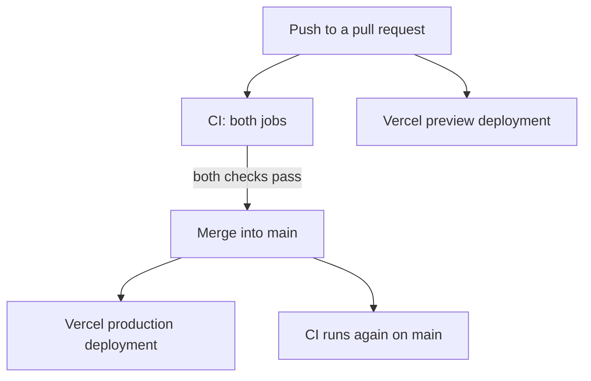

# Continuous integration

GitHub Actions runs one workflow, **CI** ([`.github/workflows/ci.yml`](../.github/workflows/ci.yml)),
on every pull request and every push to `main`. It has two jobs that run side by side:

- **Lint, types, unit tests and build:** ESLint, `tsc -b`, the production build and Vitest.
- **End-to-end tests:** the Playwright suite, in Chromium with a fake camera, against a production
  build.

CI doesn't deploy. Vercel's Git integration still builds and deploys every push on its own (see
[Deploying to Vercel](../README.md#deploying-to-vercel)). Once `main` requires both checks (see
[Making CI required](#making-ci-required)), a change reaches production only after CI has passed
on it.



## Why

Before this workflow, the only automatic check was Vercel's build. `npm run build` starts with
`tsc -b`, so a type error failed the deploy, but nothing ran ESLint, the unit tests or the
end-to-end tests unless someone ran them by hand. Several of those tests catch mistakes that build
fine and break only on the deployed site:

- an edited theme snippet in `index.html` whose hash no longer matches the CSP in `vercel.json`, so
  browsers block it (`tests/csp.test.ts`);
- a `connect-src` that no longer matches the shared booth's signaling host, so devices can't pair
  (`tests/csp.test.ts`);
- routes in `vercel.json` that stop serving the app, or swallow the `/_vercel/` routes Web
  Analytics needs (`tests/vercel.test.ts`);
- export sizes, filters and crops that are off (the Vitest suites under `src/`, and the Playwright
  sessions that download real PNGs);
- a shared booth that no longer connects, shoots or retakes on both devices
  (`e2e/shared-booth.spec.ts`).

## When it runs

| Event | What runs |
| --- | --- |
| A pull request is opened or reopened, or gets a new push | Both jobs, on the PR's merge commit: the code `main` would have after merging |
| A push to `main` (a merged pull request, or a direct push) | Both jobs |
| **Run workflow** in the Actions tab (`workflow_dispatch`) | Both jobs, on the branch you pick |

- **Branches without a pull request** don't run CI, though Vercel still deploys a preview for
  them. Open a pull request (a draft is enough) to get CI on a branch.
- **A new push cancels the run it replaces** on the same pull request, so only the latest commit
  is tested. Runs on `main` are never cancelled, so every commit there gets a result.
- **Pull requests from forks** run the same way. The workflow needs no secrets, and its token can
  only read the repository (`permissions: contents: read`).

## The jobs

### Lint, types, unit tests and build

| Step | Command | Fails when |
| --- | --- | --- |
| Install dependencies | `npm ci` | `package-lock.json` is out of sync with `package.json` (`npm ci` refuses to update the lockfile) |
| Lint | `npm run lint` | ESLint finds an error, including the React hooks rules |
| Type check | `npm run typecheck` | `tsc -b` finds a type error in the app (`tsconfig.app.json`) or in the configs, tests and e2e code (`tsconfig.node.json`) |
| Build | `npm run build` | The build Vercel runs for every deploy would fail |
| Unit tests | `npm test` | A Vitest test fails |

- **Every check runs, even after another one fails.** The steps after the install run unless the
  install failed or the run was cancelled (`if: ${{ !cancelled() && steps.install.outcome ==
  'success' }}`), so one run reports a lint error and a failing test together. A type error shows
  up twice, in Type check and in Build, because the build starts with `tsc -b`.
- **Unit tests come after the build on purpose.** One test in `tests/csp.test.ts` checks the inline
  scripts of every page in `dist/` against the CSP, and it skips itself when `dist/` doesn't
  exist.

### End-to-end tests

1. **Install dependencies** with `npm ci`.
2. **Install Chromium** with `npx playwright install --with-deps chromium`. `--with-deps` adds the
   system libraries Chromium needs on Ubuntu. The browser version always matches the
   `@playwright/test` version in the lockfile.
3. **Run Playwright** with `npm run test:e2e`. `playwright.config.ts` does the rest:
   - It starts a local PeerServer (`npx peerjs --port 9000`).
   - It builds the app with `VITE_PEER_*` pointed at that server and no STUN/TURN servers, and
     serves `dist/` with `vite preview` on port 4173. The shared-booth tests never reach the PeerJS
     cloud server, so nothing outside the runner can make them fail.
   - It launches Chromium with a fake camera and camera permission granted, and blocks service
     workers so a cached build can't answer instead of the new one.
4. **Upload the Playwright report**, only when the job fails (see
   [When a check fails](#when-a-check-fails)).

This job builds the app a second time because the end-to-end build is a different build: its
`VITE_PEER_*` values point the shared booth at the local server. That's also why it doesn't wait
for the other job.

## Implementation

The change is three files plus a link from the README.

| File | What it holds |
| --- | --- |
| [`.github/workflows/ci.yml`](../.github/workflows/ci.yml) | The workflow: triggers, concurrency, permissions and both jobs |
| [`playwright.config.ts`](../playwright.config.ts) | Three settings that apply only when `CI` is set (GitHub Actions always sets it) |
| `docs/ci.md` | This page |

### The workflow

- **Node version.** `actions/setup-node` reads it from `engines.node` in `package.json` (`22.x`),
  the same field Vercel reads, so the version is set in one place for both. If `package.json` ever
  gets a `devEngines.runtime` field, setup-node reads that instead.
- **npm cache.** `cache: npm` caches npm's download cache, keyed on `package-lock.json`. Each job
  still runs a clean `npm ci`; only the downloads are skipped.
- **Concurrency.** The group is the workflow plus the ref (`refs/pull/<number>/merge` for a pull
  request, `refs/heads/main` for `main`). `cancel-in-progress` is true only for pull requests.
- **Permissions.** The token gets `contents: read` and nothing else. Nothing in the workflow writes
  to the repository.
- **Timeouts.** 15 minutes for the first job and 20 for the end-to-end job, well above a normal
  run. A hung server or browser then fails the job instead of using up the default six hours.
- **Action versions.** `actions/checkout`, `actions/setup-node` and `actions/upload-artifact` are
  pinned to their major version (`@v7`), which still receives fixes and security patches.
- **Artifact name.** The report is uploaded as `playwright-report-attempt-<n>`. Artifact names must
  be unique within a run, so a re-run gets its own name instead of failing the upload.

### Playwright settings on CI

| Setting | On CI | Locally | Why |
| --- | --- | --- | --- |
| `forbidOnly` | `true` | `false` | A `test.only` committed by mistake fails the run instead of silently skipping every other test |
| `retries` | `1` | `0` | WebRTC and timing on a shared runner can stall a test once. A test that passes on its retry is marked **flaky** in the log and the report, and the run stays green |
| `reporter` | `list`, `github`, `html` | `list` | `github` puts failures on the run's summary page as annotations; `html` writes `playwright-report/` with the traces of failed tests |
| `reuseExistingServer` | `false` | `true` | Already in the config: CI always starts a fresh PeerServer and a fresh build |

## Making CI required

The workflow only reports results. To stop a red pull request from merging, and so from deploying
to production, protect `main` with a ruleset. This is a one-time setting on GitHub, not something
the repository can carry:

1. Merge this workflow, or run it once, so GitHub knows the two check names.
2. Go to the repository's **Settings → Rules → Rulesets → New ruleset → New branch ruleset**.
3. Name it (for example `main`), set **Enforcement status** to **Active**, and under **Target
   branches** choose **Add target → Include default branch**.
4. Turn on **Require a pull request before merging**. Without it, a direct push to `main` still
   deploys to production without waiting for CI.
5. Turn on **Require status checks to pass**, and add both checks:
   - `Lint, types, unit tests and build`
   - `End-to-end tests`
6. Optionally, turn on **Require branches to be up to date before merging**. CI tests a pull
   request merged with `main` as it was at the last push; this option makes GitHub ask for a
   re-run after `main` has moved on.
7. Select **Create**.

GitHub enforces rulesets on public repositories on every plan, and on private repositories only
with GitHub Pro, Team or Enterprise.

## When a check fails

1. Open the pull request's **Checks** tab, or the run under **Actions**, and expand the failed
   step's log.
2. Run the same steps locally. Run the unit tests after a build, as CI does:

   ```bash
   npm ci
   npm run lint
   npm run typecheck
   npm run build
   npm test
   npx playwright install chromium   # once, and after each @playwright/test update
   CI=true npm run test:e2e          # CI's retries and reporters; drop CI=true to reuse running servers
   ```

   In PowerShell, set the variable first: `$env:CI = "true"; npm run test:e2e`.
3. For an end-to-end failure, download the `playwright-report-attempt-<n>` artifact from the run's
   **Summary** page, unzip it and run `npx playwright show-report <folder>`. Each failed test has
   its trace: every action, a DOM snapshot before and after it, console messages and network
   requests.
4. If it looks like a one-off, select **Re-run failed jobs** on the run. A test marked flaky, or one
   that fails only now and then, is still a bug to fix, not one to keep re-running.

## Maintaining it

- **Changing the Node version.** Edit `engines.node` in `package.json`. Vercel and CI both follow
  it.
- **Updating actions.** When an action releases a new major version, or GitHub announces it will
  retire the Node runtime an action uses, change `@v7` to the new major in `ci.yml` and read its
  release notes for breaking changes.
- **Adding a check.** Add an npm script, so it runs the same way locally, and a step that calls it
  in the first job with the same `if:` as the others.
- **Renaming a job.** The job's `name:` is the check's name. Rename it in the ruleset too, or
  every pull request waits for a check that never reports.

## Not covered yet

- **Formatting.** `.prettierrc` sets `printWidth: 80`, but the code is wrapped wider: more than
  1,000 lines run past 80 columns, and `prettier --check` flags 78 files. A format check first needs
  either one commit that reformats everything or a `printWidth` that matches the code.
- **Safari.** Playwright's WebKit has no fake camera, so the end-to-end tests run only in Chromium.
  Safari on iPhone and Mac is still tested by hand (see
  [Testing on an iPhone](../README.md#testing-on-an-iphone)).
- **Dependency updates.** A `.github/dependabot.yml` could open weekly pull requests for npm
  packages and for these actions, and CI would test each one.
